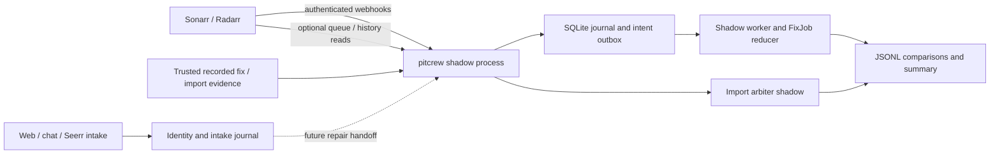

# Architecture

Pit Crew has a repair control plane and three edges. The pure domain models the
repair lifecycle; the local agent performs bounded authenticated diagnostics.
P2 adds SQLite persistence, a durable worker, read clients, webhook intake and
conservative engine/import arbiter comparisons. The `pitcrew` executable runs
only in shadow mode. P5 adds web/chat intake and a separate identity/report
journal. Its handoff to diagnosis/repair, notification delivery and a certified
live effect router remain future integration work.

The reducer accepts evidence/events and explicit time, returning a new state and
ordered intents. The store commits both atomically before the library worker
can dispatch an effect. The shipped process records effects without executing them.
Replaying committed events reconstructs the state. Delayed,
duplicated or mismatched evidence cannot certify a different file. A reservation
belongs to every grab; an uncertain accepted request must be reconciled before
retry. Failed jobs can retain an unresolved operation and media ownership fence.

The exact imported file must pass its own decode and target checks, and Plex must
publish that file before a ready notification is queued. A pre-import decode,
arr command acceptance, or refresh request alone is insufficient. A failed repair
emits one logical administrator notification intent, whose eventual delivery is
tracked separately. See [lifecycle](docs/adr/0002-fixjob-lifecycle.md) and
[store protocol](docs/adr/0004-sqlite-outbox.md).

The worker uses per-job leases and fencing tokens, revision-checked intent
claims, short transactions, and call deadlines. Job replay and outbox reconciliation
survive process death. The store reserves installation-wide and per-viewer hourly/
daily budget envelopes before a job can spend its per-job budget. Active and
quarantined work retain those reservations. The live library path is tested with
fakes; current access, exact-byte mapping and upstream semantics still need a
certified real adapter before deployment.

Webhook and bounded queue/history observations are idempotently journaled. Raw
observations cannot authorize a mutation or prove actor ownership; their shadow
proposal is `Hold`, with insufficient evidence. Authenticated recorded transcripts
can supply the missing correlation and safety facts for per-fix comparisons.
The legacy Python reports GET route can mutate state, so it is not polled. See
[shadow runtime and report schema](docs/shadow.md).

Source adapters may enrich generic symlink/mount/read/probe/decode/Plex-log
evidence; none is required for local or mounted media. Channel capabilities
constrain proactive follow-ups, while one-way admin notifiers and generic Plex
web-sign-in/short-code linking remain independent transport contracts. See
[storage](docs/adr/0001-architecture.md) and
[channels](docs/adr/0007-channels-and-notifiers.md).

Crates are grouped by purpose: `domain`, `store`, `engine`, `arbiter` for repairs;
`arr`, `plex`, `upstream`, `diagnosis`, `deciders`, `notify` for integrations and policy;
`agent` for local filesystem/process/log checks; `config` for setup;
`intake` and `intake-store` for scoped report proposals and identity proofs;
`fakes`, `scenarios`, `drill`, `xtask` for verification. No production
crate imports a fake. Rules/templates are the baseline; optional cloud providers
are behind explicit consent, redaction, grading and administrator promotion.

The public web must hold no arr or owner Plex credentials. Only authenticated
control-plane requests may select a server-resolved media identity; arbitrary
viewer-provided paths and URLs never become upstream requests. The P1 agent
confines final targets with pinned descriptors and openat2, bounds filesystem
workers and child processes, authenticates its loopback HTTP API, and preserves
Plex-log timezone/DST uncertainty. Its decode result certifies only the reported
ranges (default samples at 0%, 40%, and 80% of duration), and its local
file identity is a metadata fingerprint. See the complete
[agent limits](docs/agent.md).

The migration proceeds through the file agent, shadow engine/arbiter, then live
repair ownership. Assess that result before migrating diagnosis and intake.
An ordinary arr upgrade can import before Pit Crew probes the download. The reducer
accepts that exact import, waits and rechecks a first bad destination decode, and
rolls forward after confirmed failure. Held-category fake tests demonstrate the
stronger preservation route conditionally; real arr capabilities must be proved
before that guarantee is advertised. Admin-approved lower quality requires an
acknowledged guard against unattended re-upgrades to known-dead content.

Store-enforced item cooldown, cross-job exclusions, audited quarantine release,
persistent per-client queue-interference downgrade, and live identity/notification
transport certification remain explicit gaps. Configuration acceptance and matching
actions with unknown evidence are not readiness claims.

Deployment requires regression gates, rehearsed rollback and explicit maintainer
approval. Packaging is supplied; no live shadow, service deployment or upstream
certification was performed in this phase.

## P5 intake boundary

The web wizard and all channels propose observations through `pitcrew-intake`.
Plex membership and library sections are checked using the viewer's own token.
Stored links establish identity only; stale or unknown access cannot select media.
Parser output contains only accessible catalog identities and fixed reply copy,
never effects or inferred readiness. Ambiguous title/episode/version requests ask
for clarification, including contradictory episode numbers and negated versions.

`pitcrew-intake-store` owns browser proofs, HMAC-digested short codes, submission
idempotency, report quotas and conversation records. It deliberately does not
change the repair store's schema or lifecycle. Channel replies persist an uncertain
delivery claim before dispatch; replay does not send a second reply. The test
channel and real platform hosts share the durable intake function. See
[web](docs/web.md), [channels](docs/bot.md), and [drills](docs/intake-drills.md) for
implemented behavior and explicit integration gaps.
