# ADR 0002: A pure, persisted FixJob lifecycle

Status: accepted for P0.5 (pure domain and fake protocols; real adapters deferred)

## Context

Inferring a fix from queue snapshots and unrelated flags loses the difference between
an operation that failed and an operation that succeeded but lost its response. It
also makes it possible to announce a different file as ready, lose replacement
constraints during retry, or send another grab without reserving its budget.

## Decision

`pitcrew-domain` owns a pure reducer. `FixJob::apply(event, now)` returns a proposed
next job and numbered effect intents. It performs no I/O and never changes the
previous job. Internal job fields are private. Accepted events and input types are
serializable; a job snapshot cannot be deserialized into unchecked authoritative
state. Recovery replays accepted events with their original timestamps. Production
snapshot restore may be added with validation and a versioned schema in a later phase.

The job contains its current library file (the initial identity remains in the event journal), immutable replacement constraints, an
allocated budget envelope, the exact attempt/download/file identities, deadlines,
and any unresolved mutation. Every retry retains the same constraints. Numeric identity fields are store-assigned
opaque keys, not hashes or raw IDs shared across arr instances. Before publishing a
job, the store must persist immutable upstream metadata: release GUID, indexer,
arr instance, library mapping, download ownership and content identity. Resolving
one opaque key to a different upstream item is prohibited. File identity
includes a content revision: adapters must change it when bytes change and must
never infer identity from a release group, filename, or a path reused by another file.

Requested upstream results are `Observation` values, carried in `Event::Observed` with the
exact durable `IntentKey { job, sequence }` that produced it. A key from another
job is rejected even when its sequence happens to match. The reducer records the expected
sequence whenever it proposes upstream work. A callback must preserve its original
correlation; adapters must never relabel old results with the latest sequence.
Acceptance retains that correlation for download/import completion until the next
effect is proposed. Reconciliation queries have their own sequences. This rejects
delayed acknowledgements from previous grabs **and** old reconciliation within the
same attempt after a repeated delete/import. Exact file identity remains a separate
requirement, including when an upstream reuses a download or file identifier.

```mermaid
stateDiagram-v2
    [*] --> Picked
    Picked --> GrabIntent: authorized selection and reservation
    GrabIntent --> Downloading: acceptance linked to exact download
    GrabIntent --> GrabReconciling: uncertain response or process recovery
    GrabReconciling --> Downloading: accepted download found
    GrabReconciling --> Rejected: authoritatively absent
    Downloading --> Rejected: authoritative download failure; exclude release
    Downloading --> Imported: arr auto-import linked to original grab
    Downloading --> Downloaded: exact download completed
    Downloaded --> DownloadVerified: exact downloaded bytes decoded
    Downloaded --> DownloadRejected: decode failed
    DownloadRejected --> RejectIntent: authorized delete and blocklist intent
    RejectIntent --> Rejected: deletion acknowledged
    RejectIntent --> RejectReconciling: uncertain response or process recovery
    RejectReconciling --> Rejected: deletion established
    RejectReconciling --> RejectRetryable: download authoritatively still present
    RejectRetryable --> RejectIntent: fresh authorization
    Rejected --> GrabIntent: fresh authorization and new reservation
    Picked --> AwaitingQualityApproval: broken copy and lower-quality candidate
    Rejected --> AwaitingQualityApproval: broken current copy and lower-quality candidate
    AwaitingQualityApproval --> UpgradeGuardIntent: scoped admin approval
    UpgradeGuardIntent --> UpgradeGuardReconciling: response uncertain
    UpgradeGuardReconciling --> QualityApproved: guard confirmed installed
    UpgradeGuardReconciling --> AwaitingQualityApproval: authoritatively absent
    UpgradeGuardIntent --> QualityApproved: guard acknowledged
    QualityApproved --> GrabIntent: approval still valid; authorize and reserve
    DownloadVerified --> ImportIntent: authorized import of verified bytes
    ImportIntent --> Importing: command accepted
    ImportIntent --> ImportReconciling: uncertain response or process recovery
    ImportReconciling --> DownloadVerified: command definitely not executed
    ImportReconciling --> Imported: exact import found
    Importing --> Imported: exact download linked to new file
    Imported --> VerifyRetry: first bad destination decode
    VerifyRetry --> Imported: delayed tick; decode exact destination again
    Imported --> Rejected: second bad decode; exclude and roll forward
    Imported --> Imported: exact destination decode passed; request target check
    Imported --> Verified: decoded destination, constraints and Plex identity match
    Verified --> Done: ready intent committed
    Done --> [*]
    Failed --> [*]
```

Every nonterminal state can fail or reach its deadline; VerifyRetry uses its stage deadline as a recheck wake-up, with the total deadline still terminal. Those edges are omitted from
the diagram for readability. Unknown reconciliation results keep their existing
state and deadline. `Failed` and `Done` reject subsequent events; terminal outcomes
cannot be accidentally reopened by a duplicate webhook.

| State | Normal accepted events | Result |
| --- | --- | --- |
| Picked, Rejected | SelectRelease / SelectCandidate | Check dead identities, authorize, reserve one budget unit and propose Grab |
| Picked, Rejected | BrokenFileConfirmed / RequestLowerQuality | Exact broken-copy evidence; await approval for a lower-quality candidate |
| AwaitingQualityApproval | ApproveLowerQuality | Scoped, unexpired approval and current access; propose upgrade guard |
| UpgradeGuardIntent | Installed / Ambiguous | QualityApproved or read-only reconciliation |
| UpgradeGuardReconciling | Installed / Absent / Unknown | QualityApproved, new approval required, or unchanged |
| QualityApproved | GrabApproved | Fresh access, unexpired approval; reserve and grab |
| GrabIntent | GrabAccepted, GrabAmbiguous | Downloading or read-only reconciliation |
| GrabReconciling | Accepted, Absent, Unknown evidence | Downloading, Rejected, or unchanged |
| Downloading | DownloadCompleted | Downloaded and decode intent |
| Grab/download stages | DownloadFailed / AutoImported | Exclude and end wait, or verify exact imported destination |
| Downloaded | DownloadDecoded | DownloadVerified or DownloadRejected |
| DownloadRejected, RejectRetryable | RejectDownload | RejectIntent and scoped download deletion |
| RejectIntent | DeleteAcknowledged, DeleteAmbiguous | Rejected or reconciliation |
| RejectReconciling | Absent, Present, Unknown evidence | Rejected, RejectRetryable, or unchanged |
| DownloadVerified | RequestImport | ImportIntent using exact verified source |
| ImportIntent | ImportAccepted, ImportAmbiguous | Importing or reconciliation |
| ImportReconciling | Imported, Absent, Unknown evidence | Imported, DownloadVerified, or unchanged |
| Importing | ImportCompleted | Imported and mandatory destination decode |
| Imported | ImportedDecoded, TargetChecked | Check targets; VerifyRetry after first bad; Rejected after second bad; Verified only on exact target |
| VerifyRetry | Tick at/after retry time | New decode intent, capped by total deadline; early ticks do nothing |
| Verified | QueueReady | Done and one ready intent |
| Any nonterminal | Fail, Tick | Failure or no change before deadline |
| Done, Failed | None | Immutable terminal outcome |

### Commit and dispatch protocol

Phase 0 supplies the domain contract. The store and engine implement this protocol
before any real mutation is enabled:

1. Claim a per-job lease and a media-item lease. Read the job revision and verified
   access evidence. Selection, constraints and reporter linkage must be present in
   the same initial transaction before the job is visible to workers.
2. Atomically allocate the job's budget envelope from global hourly/daily limits.
   The reducer consumes one unit from that envelope for every grab, including a
   retry after authoritative absence. An ambiguous request never refunds a unit.
   Allocating another job cannot reuse the same envelope. The current envelope is
   a conservative Phase 0 model; future rolling budgets may use one-attempt leases.
3. Compute a transition. In one transaction, compare-and-swap the old job revision
   and write the accepted event, next state, budget consumption and all outbox rows.
   Enforce unique `(job_id, sequence)` keys. A failed transaction dispatches nothing.
4. The worker durably claims an intent before dispatch, with an attempt marker.
   Recheck current positive authorization for the exact library immediately before
   a mutation; expired, denied or unknown access cannot dispatch it. Any pending
   intent cancelled by a terminal failure must be suppressed if it has not started.
5. Send the operation once. Commit its observed result as the next event. If the
   worker dies after claiming, a transport fails ambiguously, or a response is lost,
   reconcile the claimed operation instead of blindly delivering it again. Every
   observation carries the original claimed intent sequence, including ambiguous
   results and reconciliation query results. Recovery
   from GrabIntent, RejectIntent or ImportIntent uses the corresponding ambiguous
   event and the stored release/download identity.
6. Reconciliation must examine authoritative upstream queue **and** history, including
   warning/import-blocked downloads. A missing queue row alone proves nothing.
   Transient errors produce Unknown. Read-only reconciliation can be polled until
   the existing deadline; it cannot issue another mutation or extend that deadline.
7. Notification intents remain in the outbox until acknowledged, with retry and a
   stable deduplication key. Job completion means the intent is durable, not that a
   human received a message. Exactly once **intent creation** is guaranteed; exactly
   once external delivery additionally requires downstream idempotency support. Ready delivery uncertainty without deduplication requires reconciliation/review, never a blind retry (ADR 0007).

If a job fails with an unresolved mutation or active download, those obligations
remain in the job for auditing and administrator recovery. The item lease must stay
quarantined: a new job cannot allocate another live grab for the same resource.
Phase 0 deliberately offers no terminal cleanup API. The later engine/store must
provide an explicit audited reconciliation/cleanup workflow before releasing that
quarantine; marking a job failed is never proof that an upstream action stopped.

### Safety and timing

There is no standalone library-file deletion effect. Import is the only operation
that may replace the old library file and carries the exact verified downloaded
source. The import adapter must keep that source available through atomic replacement,
validate its revision again, and preserve the old file if a replacement cannot be
established. Ordinary arr completed-download handling can import independently of this reducer.
P0.5 treats that as a normal observed path: verify the actual imported file, and roll
forward if it is still broken after the fresh-import recheck. This observation is
not permission for Pit Crew to delete an unverified library copy. The strict
preservation guarantee applies to Pit Crew's own import effects; an installation
whose arr can replace independently cannot promise end-to-end pre-import preservation.
It must expose that limitation in setup and repair evidence.

### Held-download prototype and fallback

`crates/fakes/src/holding.rs` and `tests/holding.rs` model completed-download handling
and exercise the real reducer's pre-import authorization. The result is conditional:
when a download is submitted directly into a category that **no automatic importer
watches**, it remains outside the library until an exact-source ManualImport follows
a successful decode. A bad decode leaves the original in place. A changed source
revision is rejected at import. An ordinary watched-category upgrade imports before
any probe; moving its category after completion cannot undo that replacement.

The first certification targets are the current linuxserver Sonarr and Radarr
images using their v3 APIs, paired with nzbdav's SABnzbd-compatible API. These are
**first targets, unproven**: no live version or setting has been certified. Record
the exact image digests/API versions when certification becomes possible. External
queue actors and their required exemptions are covered by ADR 0008.

A production adapter may declare this route supported only after version-specific
contract tests establish all of these requirements:

- The category is assigned **at submission**, before completion can race verification.
  A release POST followed by a category change does not meet this contract.
- Completed-download handling in every relevant arr instance and other importer
  excludes the held category and staging directory. Merely adding a dedicated client
  to arr may cause arr to watch its category, so a dedicated name alone is insufficient.
- The submission route preserves immutable release/download ownership and budget
  reservation. No untracked second download is created while rerouting a grab.
- ManualImport can select the exact held path, download identity and revision despite
  that category being excluded. The staging path is visible to the importing arr.
- The source remains available through replacement, and adapter recovery reconciles
  command/history results after a lost response or restart.

The required administrator settings are an isolated staging directory/category,
completed-download handling that excludes it (or a dedicated submission route outside
arr's automatic handling), mapped paths for ManualImport, and no competing import
watcher. **Actual setting names and per-client versus global support remain unverified.**
Do not disable global handling silently to make the prototype appear supported.
Check supported Sonarr/Radarr and download-client APIs when building those adapters.
The fake proves the protocol assumption, not that a current release exposes it.

If any capability is absent or uncertain, use `VerifyAfterImport`: observe an exact
import correlated to our grab, decode its destination, delay and recheck a first bad
result, and reserve a new attempt to roll forward after confirmed failure. Never
attempt to reconstruct a deleted old file or report readiness merely because arr
calls the replacement an upgrade. Loss of proven holding isolation is a visible
capability downgrade, not an implicit bypass of source verification on a manual import.

Rejected-download deletion is a different effect: it always blocklists
and sets `skip_redownload`, and cannot name a library file.

A download reserves the single active slot from GrabIntent through confirmed deletion,
authoritative terminal download failure, or exact import. Blocked downloads and uncertain POSTs still occupy it. The reducer
cannot select another release until that slot has been cleared by authoritative
results. Budget reservation is part of the same proposed state that carries Grab.

Ready requires mandatory decode of the **exact imported destination**, an import-history
link to the job's download, satisfied persistent replacement constraints, and Plex
publishing that same content identity. Pre-import decode never substitutes for this
check. A changed file revision invalidates evidence. The adapters authenticate and
normalize observations; viewer text must never be converted directly to these events.

Every nonterminal stage has an absolute deadline. A state change starts its stage
budget, capped by the job's absolute total deadline. Ticks and unknown reconciliation
results cannot reset it. At an ordinary stage deadline (including exact equality), any event produces
a visible deadline failure and exactly one admin notification intent plus an honest
viewer-failure intent. VerifyRetry is the explicit exception: a due Tick requests
a second exact-destination decode; a total deadline always fails, even then. The reducer uses caller-supplied monotonic logical timestamps;
clock regressions are errors. `StageTimeouts` supplies download, import, decode and
fresh-import recheck durations; other stages use `Policy.stage_timeout` and all are
capped by `Policy.total_timeout`. Per-client defaults are download 180 seconds for
cached/local sources (3,600 for uncached torrents), import 120, decode 180 and recheck
180. The config maps directly to these domain durations. A large remux or slow mount
must have a bounded opportunity to finish; a fast initial failure cannot skip the
fresh-import delay.

### P0.5 failure, retry and downgrade contracts

`DownloadFailed` is an authoritative terminal client/history observation, correlated
to the attempt's original grab key and download ID. It immediately excludes that
release, ends the wait and clears the active slot; a queue miss or transport error
cannot be relabeled a download failure. The budget remains spent. The slot may also clear when reconciliation proves a grab absent. Correlation works
even when completion/failure arrives before the grab response; old attempts and
cross-job keys are rejected. `AutoImported` uses the same stable original grab key,
independent of any later decode intent, so an import racing the first probe enters
normal destination verification. Events arriving during an already outstanding
remove/manual-import mutation require adapter reconciliation; this foundation does
not claim to solve every external import/delete race. The ownership fence remains
until those obligations are resolved.

A first bad imported decode records `VerifyRetry` without excluding the release or
announcing failure. Early ticks do nothing; a due tick requests another decode with
a new intent key. Only a second bad result excludes that attempt and returns to
`Rejected`, preserving the currently installed file for a budgeted roll-forward.
The next import's `original` identity is that current file, not the old pre-job path.
No release is called ready before an exact imported decode and target check pass.

Exclusions retain opaque release identity plus all available scoped GUID, infohash
and client-download aliases. A renamed candidate matching any dead identity is
rejected before reservation/dispatch. Real adapters must use `SelectCandidate` with
all available identifiers and a verified quality comparison. Legacy `SelectRelease`
is an opaque-key compatibility input with no extra identity and assumes same-or-better;
it must not be used to discard known aliases or bypass a lower-quality approval. Persist and share exclusions per media item
across jobs in the future store; the reducer currently retains this job's evidence.

Lower quality is opt-in per candidate, never a global weakening of selection. The
trusted evidence boundary first confirms the current file broken; a lower-quality
request then enters `AwaitingQualityApproval`. An authenticated administrator grant
must name this job, selected release and exact broken file, and must remain unexpired.
Fresh library authorization is required both for approval/guard installation and
again before the grab. Language/SDR constraints and every verification rail remain.

Before grabbing, persist `InstallUpgradeGuard`: fence unattended upgrades for the
media item and retain known-dead identities, preventing arr from immediately replacing
the accepted lower-quality copy with the dead higher-quality release. An ambiguous
guard result is reconciled; no grab runs until installation is confirmed. An adapter
unable to guarantee that guard must fail closed. Reconciliation proving it absent
returns to approval; a delayed grab cannot outlive its approval. The later adapter
must persist/reconcile the guard across jobs/restarts, show it to the administrator,
and require explicit review before lifting it. No broad quality-profile change,
automatic unmonitoring, or real arr guard is implemented by this domain prototype.

## Refinements to the original lifecycle

Explicit reconciliation states cover ambiguous POST, DELETE **and import command**
results. Download rejection is separated from confirmed deletion so a second grab
cannot race a still-active rejected download. ImportIntent is separate from Importing:
command acceptance does not establish that a replacement landed. Imported includes a
stored exact-destination decode result before target checks; Verified precedes the
transaction that records the ready intent. These distinctions directly prevent the
reviewed duplicate-grab, lost-delete, premature-ready, lost-language and lost-notification
bug classes.

## Validation and consequences

The tests enumerate every state/event pair and all reconciliation outcomes, check
exact effect payloads and durable keys, exercise deadline and authorization boundaries,
and replay after every transition. Delayed callbacks are tested across attempts,
within repeated operations on the same attempt, and with reused file identities. Property tests mix guided valid paths with arbitrary
event order, retries and failures to exercise all seven safety rails. CI mutation-tests
the domain crate without suppressing rail code.

The reducer cannot prove that an adapter's evidence is truthful or that a database
transaction has committed. Those are explicit contracts, enforced by store/engine
fault-injection and upstream-contract tests in later phases. No live services, network
clients, database, worker concurrency or delivery transport are implemented here.
